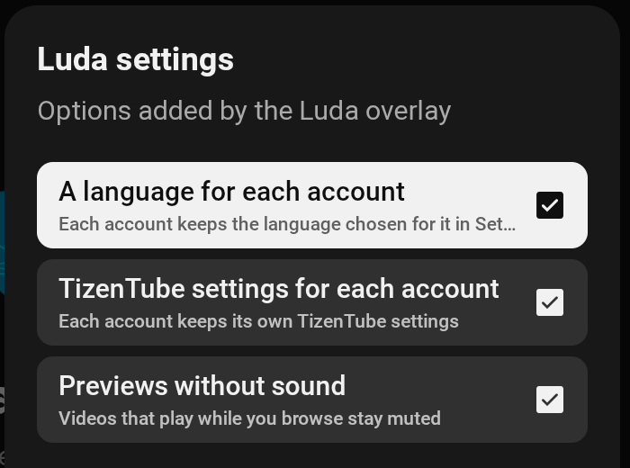

# Luda overlay

A small add-on that runs on top of [TizenTube](https://github.com/reisxd/TizenTube) on Android TV. It adds a few household features without copying or changing TizenTube itself, so TizenTube's own features keep updating exactly as before.

> **Status: early.** It runs on one TV so far. The table says what is true today.

## Features

| Feature | What it does | Status |
|---|---|---|
| Language that sticks | Makes the app's own Language setting take effect | Working |
| A language for each account | Each account, and guest mode, keeps its own interface language | Working |
| Settings for each account | Each account keeps its own TizenTube settings | Working |
| Silent previews | Previews play while you browse, turned down until they can't be heard; opening a video restores the sound | Working |
| Luda menu | One extra entry in Settings to switch the options above on and off | Working |

"Working" means tested on one Android TV with TizenTube Cobalt 2.0.3, one signed-in account and guest mode.



## How it works

```
TizenTube app (official release, wrapped)
        │  loads one script address
        ▼
   loader.js @<commit>  ──►  TizenTube's own script, from its usual address, always the latest
        │
        └──────────────────►  overlay.js @<same commit>, the add-on
```

TizenTube's app loads its script from a single address. A wrapped copy of the app has that one address changed to `loader.js` from this repository, pinned to a commit; nothing else in the app is touched. The loader then does two things, in order:

1. It loads TizenTube's script from where TizenTube publishes it.
2. It loads `overlay.js` from the same commit as itself.

Because TizenTube's script is never copied here, there is nothing to keep in step with it.

### Why commits and not `@main`

The app only runs scripts from jsDelivr. jsDelivr serves a branch address such as `@main` from caches that can stay hours behind, and some of its servers kept serving the very first version of this add-on long after newer ones were published. A commit address never changes, so a wrapped app always gets exactly the files it was tested with.

## Updates

| What | How it updates |
|---|---|
| TizenTube's features | By themselves at every start, as in the official app |
| This add-on | With a new wrapped app: wrap again with the new commit, then install it over the old wrapped app (no sign-out) |
| The app itself | Each new TizenTube release has to be wrapped again |

A wrapped app is signed with your own key, so:

- the first install replaces the official app only after uninstalling it, which signs every account out once; later wrapped versions install over it and keep everything;
- TizenTube's built-in app updater can no longer install new versions over it.

## Wrapping a TizenTube release

You need `unzip`, `zip`, `python3`, a JDK, and `zipalign` and `apksigner` from the Android build-tools.

```bash
LUDA_LOADER_URL=https://cdn.jsdelivr.net/gh/Denmokin/luda-overlay@<commit>/loader.js \
  tools/patch-apk.sh cobalt-arm.apk tizentube-luda-arm.apk
adb uninstall io.gh.reisxd.tizentube.cobalt     # only when replacing the official app
adb install -r tizentube-luda-arm.apk
```

The address may be at most 69 characters, the length of the one it replaces; a shorter one is padded with `#`. The script stops without changing anything if the original address is not found exactly once, which is what will happen if a future TizenTube release moves it.

## Files

| File | Purpose |
|---|---|
| `loader.js` | Loaded by the wrapped app; loads TizenTube, then the add-on |
| `overlay.js` | The add-on |
| `dev.js` | A loader for development only. It takes the add-on from a server on the TV's own address and runs commands from it. Do not wrap an everyday app with it |
| `tools/patch-apk.sh` | Wraps an official TizenTube release |

## Credits

All the heavy lifting is TizenTube's, by Reis Can and its contributors. This project only adds to it and is not affiliated with TizenTube, with Google, or with the video service the app shows.
